

  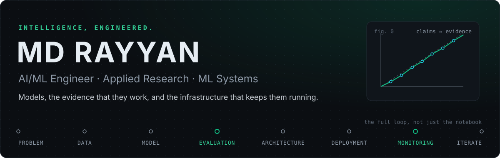

  <b>Every result on this page links back to the file it came from, and every team project says which part was mine.</b>

  <a href="https://arxiv.org/abs/2609.39067">arXiv</a> · <a href="https://www.linkedin.com/in/md-rayyan/">LinkedIn</a> · <a href="mailto:rayyan1652@gmail.com">rayyan1652@gmail.com</a> · <a href="https://rayyan-mohammed.vercel.app/">Portfolio</a> · Hyderabad, India

<table>
  <tr><td><b>Builds</b></td><td>ML infrastructure, tool-using LLM agents, evaluation pipelines, research pipelines at full-dataset scale (1.34M proteins)</td></tr>
  <tr><td><b>Strongest work</b></td><td><a href="#argus">Argus</a> (spot-resilient training on AWS EKS) · <a href="#obscuron">Obscuron</a> (calibrated novelty detection) · <a href="#bharathealth-analyst">BharatHealth Analyst</a> (benchmarked LLM agent)</td></tr>
  <tr><td><b>Research</b></td><td>Paper presented at IEEE ICAESIS-2026 (Obscuron) · arXiv preprint on predicting cloud interruptions (Argus)</td></tr>
  <tr><td><b>Now</b></td><td>B.Tech CSE (Data Science), SVKM's NMIMS Hyderabad, graduating June 2027</td></tr>
</table>

## `01` Engineering profile

I work where machine learning meets the systems around it. My projects usually start from a question a model can't answer on its own. *Will this training job survive a Spot reclaim? Does this novelty score mean anything? Does the agent's answer match the data?* They end with a running system, a benchmark, and a written record of what held up and what didn't.

My default unit of work is a pipeline with an evaluation, not a notebook with a plot. That means evaluation protocols frozen before results arrive, leakage checks before headline numbers, decision logs next to the code, and limitations stated in the README instead of discovered by a reviewer. Most of my strongest work is collaborative, so each project below says which part was mine.

Outside the repositories I lead the Code IT Club at NMIMS Hyderabad and serve as a Google Cloud Student Ambassador.

## `02` Flagship systems

Seven systems: three featured in depth, four in brief. Every number below comes from a result file committed in that project's repository.

### Argus

<a href="https://github.com/Angshuman1211/Argus-Spot_Resilient_ML_Training_Orchestrator">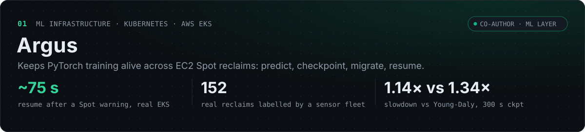</a>

**Problem.** EC2 Spot capacity costs 70–90% less than on-demand but can be reclaimed with two minutes' notice, so a long training run loses everything since its last checkpoint. 
**Approach.** A risk service scores interruption risk. A `kopf` Kubernetes operator acts on it: it tells the training pod to flush a checkpoint to S3, cordons the node, recreates the pod elsewhere, and the job resumes from the last epoch. The AWS two-minute warning drives the same recovery path reactively. 
**What it showed.** Reacting to the notice is enough while a checkpoint fits inside two minutes. Beyond that, the retrained model beats every non-learned baseline in the trace-driven benchmark. On 152 real reclaims, though, price history has no predictive skill (AUROC 0.53), while AWS's placement score does (0.74–0.77). Both results are in the revised paper in the repository. 
**My role.** Co-author with [Angshuman Chakravertty](https://github.com/Angshuman1211). I owned the ML layer: feature pipeline, risk models, FastAPI prediction service, the PyTorch training job, the benchmark harness and trace simulator, the real-reclaim sensor campaign, and the v2 operator changes (flush handshake, migration cooldown, pod recreation, capacity risk signal). 
**Stack.** `Python` `PyTorch` `XGBoost` `FastAPI` `Kubernetes` `kopf` `Helm` `AWS EKS · S3 · Lambda · SQS` `Prometheus` `Grafana` `MLflow` 
**Links.** [Repository](https://github.com/Angshuman1211/Argus-Spot_Resilient_ML_Training_Orchestrator) · [Paper, arXiv:2609.39067](https://arxiv.org/abs/2609.39067) · [Project page](https://angshuman1211.github.io/Argus-Spot_Resilient_ML_Training_Orchestrator/) · [Decision log](https://github.com/Angshuman1211/Argus-Spot_Resilient_ML_Training_Orchestrator/blob/master/docs/problems_and_decisions.md)

<b>Limitations, as stated in the repository</b>

- The ~75 s real-EKS recovery came from the reactive path, using a schema-conformant *injected* interruption warning rather than an AWS-issued FIS reclaim.
- The price model is trained on a proxy label (price spikes) and has no skill on real reclaims.
- The capacity model comes from two days of small sensor instances in four regions.
- The operator manages pods individually and does not coordinate a multi-node synchronous job.

 

### Obscuron

<a href="https://github.com/Angshuman1211/Obscuron">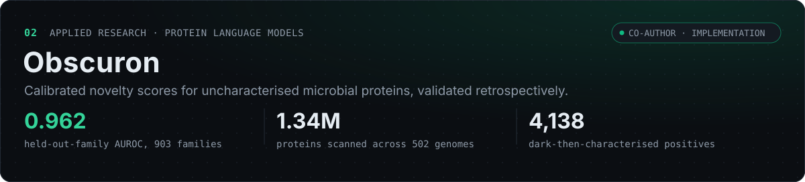</a>

**Problem.** About 22% of proteins in the benchmark panel match no known family. A detector that claims to find the interesting ones has no ground truth to be checked against. 
**Approach.** Manufacture one retrospectively. Freeze reference databases at a 2021–22 snapshot, score what was "dark" then, and grade those scores against a later snapshot in which some of those proteins have since been characterised. The core scorer is a kNN distance in ESM-2 embedding space, calibrated with an extreme-value (GPD) tail fit so its output is a p-value with a checkable false-flag rate. Four further layers add structure-aware embeddings, immune-inspired negative selection, multi-signal convergence and coding-structure statistics. 
**What it showed.** 0.962 mean held-out-family AUROC across 903 Pfam families, with observed false-flag rates matching the nominal level. It also found that, on the 4,138 positives themselves, novelty ranks at chance (AUROC 0.47 against still-dark proteins). Novelty *anti-predicts* near-term characterisation, and the repository reports this rather than smoothing it over. 
**My role.** Co-author with Angshuman Chakravertty. I owned the implementation and experimental-execution track: ingestion and snapshot differencing, embedding extraction, the EVT scorer implementation, immune-layer sweeps, full-scale flagging infrastructure and reproducibility tooling. 
**Stack.** `Python` `PyTorch` `Hugging Face` `ESM-2` `ProstT5` `SciPy` `AWS (GPU)` `uv` 
**Paper.** Presented at IEEE ICAESIS-2026 ([see Research](#04-research)). 
**Links.** [Repository](https://github.com/Angshuman1211/Obscuron) · [Decision log](https://github.com/Angshuman1211/Obscuron/blob/main/docs/problems_and_decisions.md) · [Reproducibility notes](https://github.com/Angshuman1211/Obscuron/blob/main/docs/reproducibility.md)

<b>Limitations, as stated in the repository</b>

- "Characterised later" is a Pfam-37 net-new-family proxy, not a full InterProScan run, so the positive count is a floor.
- The leakage-controlled genome-model arm may still be affected by pretraining overlap; a direct test did not confirm or rule that out.
- No wet-lab validation: every result is a computational prioritisation signal.
- Minimal automated tests; correctness rests on logged manual runs.

 

### BharatHealth Analyst

<a href="https://github.com/Rayyan-mohammed/aarogya-lens">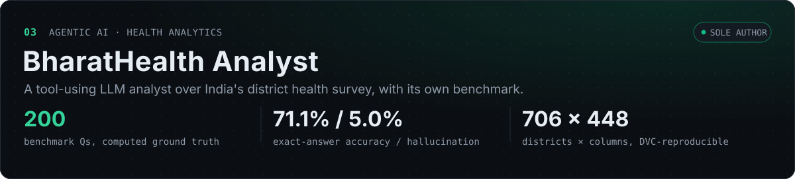</a>

**Problem.** India's National Family Health Survey (NFHS-5) publishes district-level data for 706 districts as CSVs and long PDF reports. A simple policy question means hand-sorting columns, and a trend question means aligning a second survey. 
**Approach.** A LangGraph ReAct agent plans calls across seven tools over a DVC-tracked dataset: semantic search in ChromaDB, restricted pandas execution, SQL, charts, trend and correlation analysis. It is served by FastAPI behind a static web app with Ask, Explore and Correlate views. 
**What it showed.** On a 200-question benchmark with programmatically computed ground truth: **71.1%** exact-answer accuracy, **82.0%** answer faithfulness, **5.0%** hallucination rate. Four scorer bugs were found and fixed and the run rescored. A routing fix raised trend-question accuracy from 54.4% to 84.5% on a full re-run of that category. 
**My role.** Sole author: data pipeline, agent and tools, API, web app, evaluation harness, deployment. 
**Stack.** `Python` `LangGraph` `ChromaDB` `sentence-transformers` `pandas` `FastAPI` `Next.js` `DVC` `GitHub Actions` `Docker` 
**Links.** [Repository](https://github.com/Rayyan-mohammed/aarogya-lens) · [Live site](https://rayyan-mohammed.github.io/aarogya-lens/) · [Technical report](https://github.com/Rayyan-mohammed/aarogya-lens/blob/main/docs/TECHNICAL_REPORT.md)

<b>Limitations, as stated in the repository</b>

- The live Q&A backend runs on one machine behind a tunnel, so it is sometimes offline. Explore works regardless.
- NFHS-4 trend data is state-level, so trends are disclosed as state-baseline comparisons.
- Only one of five benchmark categories has been re-run since the routing fix.
- The faithfulness scorer still undercounts one markdown answer format.

 

### Doppel

<a href="https://github.com/Angshuman1211/Doppel">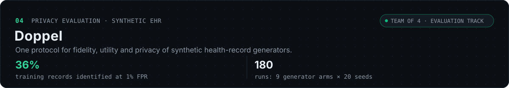</a>

A benchmark that grades synthetic health-record generators (Gaussian copula, CTGAN, TVAE, tabular diffusion) on fidelity, downstream utility and privacy under a single protocol. The result is a trade-off, not a winner. The diffusion model has the best fit of any neural generator, and it also leaks most: a membership attack identifies 36% of its training records at a 1% false-positive rate. The attacks are calibrated against exact-copy and unseen-data controls. A weak 4-column attack rated TVAE the safest arm (0.499) even though TVAE copies about half its training rows, which is why privacy is scored as the worst of three attacks. 
**My role.** Evaluation track in a team of four: evaluation protocol, fidelity, utility and membership-inference modules, attack calibration, Pareto analysis, the literature survey and the React results dashboard. 
**Stack.** `Python` `scikit-learn` `PyTorch` `CTGAN` `React` `Docker` `Kubernetes` 
**Links.** [Repository](https://github.com/Angshuman1211/Doppel) · [Live dashboard](https://doppel-six.vercel.app/) · [Evaluation protocol](https://github.com/Angshuman1211/Doppel/blob/main/docs/eval_protocol.md)

 

### CALIBER

<a href="https://github.com/Angshuman1211/CALIBER">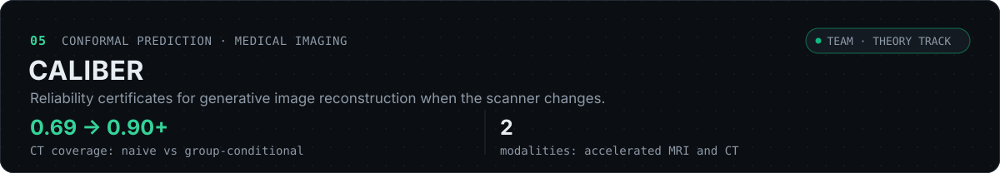</a>

Conformal reliability certificates for generative-prior image reconstruction assume a fixed acquisition operator. CALIBER shows the guarantee breaks when the operator shifts between calibration and deployment, restores it with group-conditional calibration, and bounds the coverage gap as a function of operator distance. It is demonstrated on accelerated MRI and sparse-view and limited-angle CT. 
**My role.** Theory track: the formal review of the non-exchangeable conformal setting, the coverage-gap stability bound and its revisions, the ill-posedness scaling analysis, and the numerical-verification harness and tests. 
**Stack.** `Python` `PyTorch` `diffusion / flow posterior samplers` `conformal prediction` `NumPy` `pytest` 
**Links.** [Repository](https://github.com/Angshuman1211/CALIBER)

 

### DermaAegis

<a href="https://github.com/Angshuman1211/DermaAegis-SmartHorizon">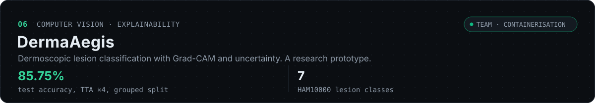</a>

Seven-class dermoscopic lesion classification on HAM10000. It uses an EfficientNetB3 transfer-learning backbone, test-time augmentation, Monte Carlo dropout for uncertainty, Grad-CAM overlays to show which region drove each prediction, and a skin-tone (Fitzpatrick) bias analysis, served through FastAPI with React and Streamlit front ends. It is a research prototype, not a diagnostic tool: recall on rare classes is weak (actinic keratosis 0.36). 
**My role.** Team project. I containerised the stack: Dockerfiles for the API and front end, and the Docker Compose setup. 
**Stack.** `Python` `TensorFlow / Keras` `OpenCV` `FastAPI` `React` `Docker` 
**Links.** [Repository](https://github.com/Angshuman1211/DermaAegis-SmartHorizon)

 

### PharmaFlow Pro

<a href="https://github.com/Rayyan-mohammed/Pharma-Flow-Pro">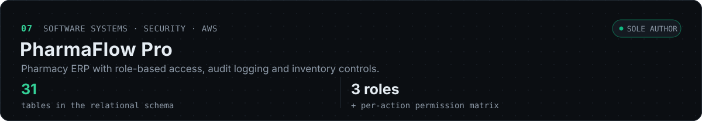</a>

A pharmacy ERP covering sales and returns, purchasing and supplier payables, prescriptions, batch and expiry tracking, cash-register sessions and reporting, built on a 31-table MySQL schema. Security is built in: per-session CSRF tokens checked with constant-time comparison, login throttling with lockout, session regeneration on login, a per-action role permission matrix, and an activity log across workflows. Reorder suggestions are rule-based, driven by per-medicine reorder levels. It was deployed on AWS Elastic Beanstalk with RDS. 
**My role.** Sole author. 
**Stack.** `PHP` `MySQL` `PDO` `JavaScript` `Bootstrap` `Chart.js` `AWS Elastic Beanstalk · RDS` 
**Links.** [Repository](https://github.com/Rayyan-mohammed/Pharma-Flow-Pro) · [Schema and ER model](https://github.com/Rayyan-mohammed/Pharma-Flow-Pro/blob/main/docs/project-abstract-and-er-model.md)

## `03` System architectures

Drawn from each repository's code and documentation. In team projects, emerald marks the components I built. In solo projects, it marks the components that carry the design.

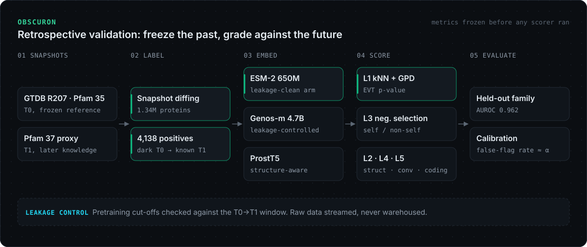

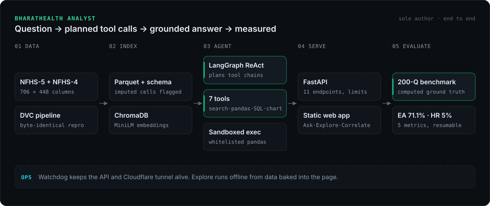

<b>Doppel · CALIBER · DermaAegis · PharmaFlow Pro</b>

 

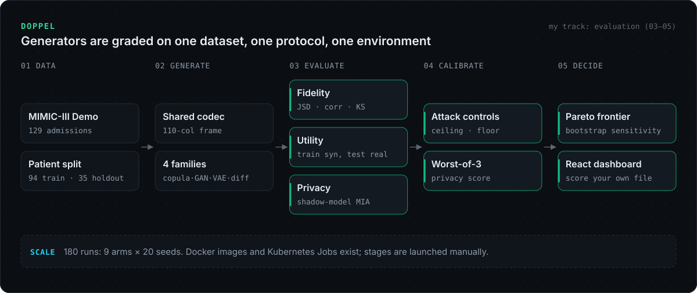

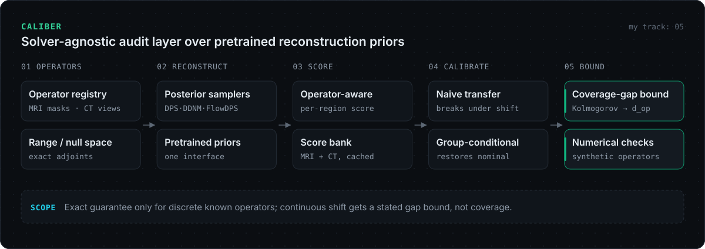

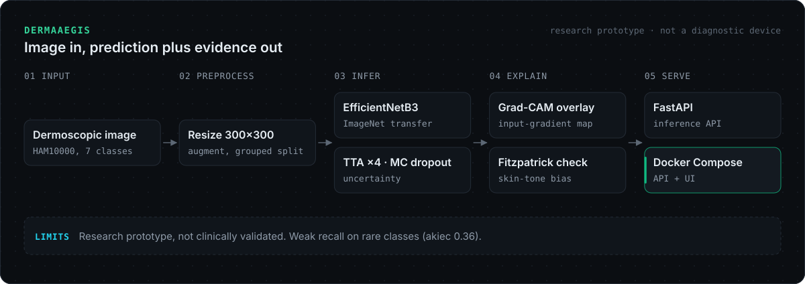

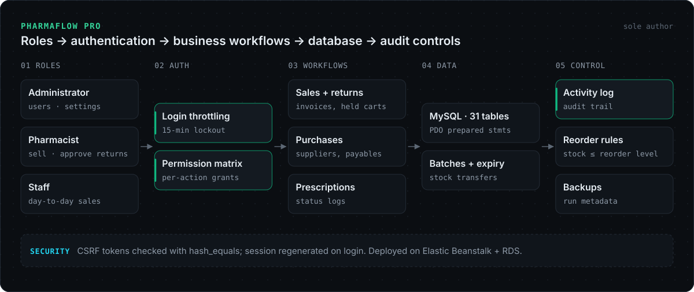

## `04` Research

| Work | Authors | Status |
|---|---|---|
| **Calibrated Novelty Detection for Microbial Dark Matter via Leakage-Controlled Retrospective Validation** (Obscuron) | A. Chakravertty, **MD Rayyan** | Presented at IEEE ICAESIS-2026, Mohan Babu University, Tirupati, 29–31 October 2026. |
| **Argus: A Real-EKS Study of When Predicting Spot Interruptions Beats Simple Checkpointing** | A. Chakravertty, **MD Rayyan** | Preprint, [arXiv:2609.39067](https://arxiv.org/abs/2609.39067) (v1, Sep 2026). Not accepted at the NeurIPS 2026 ML for Systems workshop. A v2 answering the reviews, with real-reclaim results, is [in the repository](https://github.com/Angshuman1211/Argus-Spot_Resilient_ML_Training_Orchestrator/tree/master/Paper/v2) and not yet on arXiv. |
| **CALIBER:** operator-shift-robust conformal hallucination flagging for image reconstruction | Three-track team; theory track is mine | Ongoing. Preprint draft is in the repository and not yet posted. |

## `05` Technical expertise

Listed only where a repository shows the tool doing real work.

| Area | Tools | Where |
|---|---|---|
| Machine learning | Python, PyTorch, XGBoost, scikit-learn, TensorFlow/Keras, SHAP | Argus, Obscuron, Doppel, Traffic Sign Recognition, Parkinson's |
| Foundation models | Hugging Face Transformers, ESM-2, ProstT5, wav2vec2, sentence-transformers | Obscuron, Parkinson's, BharatHealth |
| LLMs and agents | LangGraph, ChromaDB, FAISS, Claude API, Gemini API, claim-level RAG verification | BharatHealth, CodeSwitch-Verify |
| Evaluation and statistics | Conformal prediction, extreme-value calibration, membership-inference attacks, grouped cross-validation, bootstrap intervals | CALIBER, Obscuron, Doppel, Parkinson's |
| Cloud and infrastructure | AWS (EC2, S3, EKS deployments, Elastic Beanstalk, RDS), Kubernetes (kopf operator, Helm), Docker | Argus, PharmaFlow, DermaAegis |
| MLOps | MLflow, DVC, GitHub Actions (CI), uv | Argus, BharatHealth, Obscuron |
| Backend and apps | FastAPI, Flask, Streamlit, Next.js, React, PHP | BharatHealth, Doppel, PharmaFlow, OptiPrice, phishing URL detector |
| Data | pandas, NumPy, SQL (MySQL, SQLite), Parquet | Everywhere |

## `06` Engineering principles

| Principle | In practice |
|---|---|
| **Evaluate before claiming** | BharatHealth's agent is graded on 200 questions with computed ground truth. When four scorer bugs turned up, the run was rescored, not re-explained. |
| **Leakage is the default failure mode** | Obscuron separates a protein model whose pretraining predates the benchmark window from a genome model whose pretraining overlaps it. Doppel splits by patient, not admission. |
| **Calibrate, then trust** | Obscuron's scores are tail p-values with measured false-flag rates. CALIBER tests exactly when a conformal guarantee survives a change of scanner settings. |
| **Validate the attack before the defence** | Doppel's privacy attacks are calibrated against exact-copy and unseen-data controls. One weak attack rated a generator that copies half its training rows the safest, so no single attack decides the privacy score. |
| **Real failure modes need real infrastructure** | Argus's predictive path was drilled on a real EKS cluster. The drill surfaced five defects, and each was fixed. |
| **Retract what doesn't hold** | Argus reports that its price model has no skill on real reclaims, and that an earlier model's 21.8× lift fell to 2.2× on later data. |
| **Write decisions down** | Argus, Doppel, Obscuron and CALIBER each keep a numbered decision log next to the code. |
| **Security and cost are requirements** | PharmaFlow ships CSRF protection, login throttling and an audit log. Argus ends every cloud session with a teardown check after a $66 surprise bill. |

## `07` Currently exploring

Based on what I committed in October and November 2026:

- **Real labels for infrastructure ML.** Replacing proxy labels with measured ones. Argus's sensor fleet produced 152 real Spot reclaims, and a capacity-based risk model now serves alongside the price model.
- **Failure analysis for vision models.** Co-developing [Vision Error Observatory](https://github.com/Md-Zeeshan-Ali/vision-error-observatory), which locates where monocular depth models fail and tests the explanations by editing images and re-running the model.
- **Theory against measurement.** Testing CALIBER's coverage-gap bound against synthetic operators and the measured MRI and CT score banks.

<b>More work</b>

 

| Project | What it is |
|---|---|
| [CodeSwitch-Verify](https://github.com/Rayyan-mohammed/HinglishRAG-Faith) · [demo](https://d1zhxd8az51i27.cloudfront.net) | Team of two. RAG for Hinglish government-scheme questions that checks every claim in an answer against retrieved evidence before it reaches the user |
| [Parkinson's acoustic biomarkers](https://github.com/Rayyan-mohammed/Parkinson) | Voice-based detection with subject-level cross-validation, wav2vec2 features and SHAP explanations |
| [OptiPrice](https://github.com/Rayyan-mohammed/OptiPrice) · [app](https://optiprice-dynamic-pricing-agent.streamlit.app/) | Constrained price optimisation with Monte Carlo A/B simulation and SHAP-explained recommendations |
| [Urban Route Resilience](https://github.com/Rayyan-mohammed/Urban-Route-Resilience) | Team hackathon project: road extraction from satellite imagery plus graph-based network resilience analysis |
| [DNA sequence compression](https://github.com/Rayyan-mohammed/DNA-sequence-compression) | LZ77, Burrows–Wheeler and suffix-tree compression over live NCBI sequences |

## `08` GitHub activity

  <a href="https://github.com/Rayyan-mohammed">
    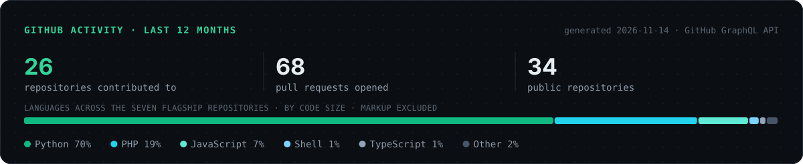
  </a>

Contribution graph

 
<picture>
  <source media="(prefers-color-scheme: dark)" srcset="https://raw.githubusercontent.com/Rayyan-mohammed/Rayyan-mohammed/output/github-contribution-grid-snake-dark.svg">
  
</picture>

## `09` Connect

I'm interested in ML systems and research-engineering work, research collaborations on evaluation and reliability, and open-source ML infrastructure.

**[rayyan1652@gmail.com](mailto:rayyan1652@gmail.com)** · [LinkedIn](https://www.linkedin.com/in/md-rayyan/) · [Portfolio](https://rayyan-mohammed.vercel.app/) · [arXiv](https://arxiv.org/abs/2609.39067) · [GitHub](https://github.com/Rayyan-mohammed)

<a href="#top">back to top ↑</a>

